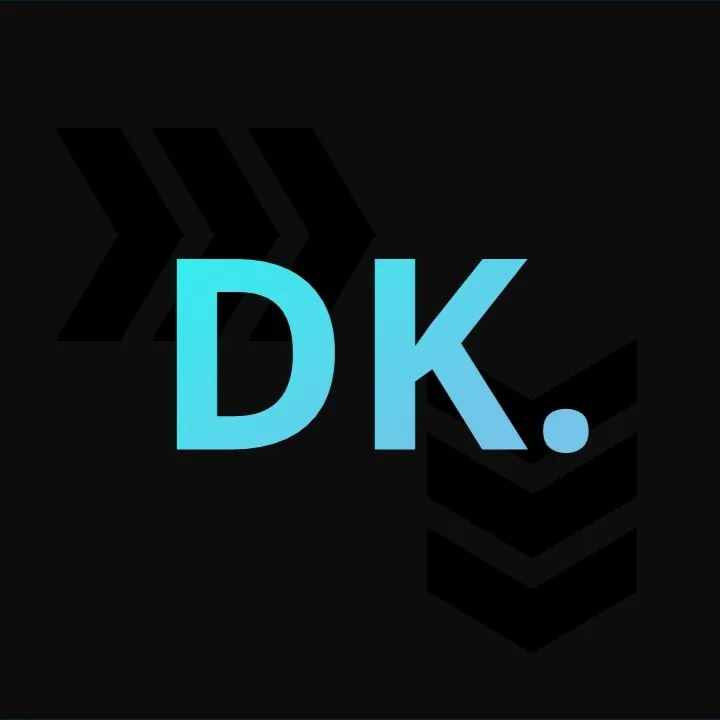

# Portfolio v2 Editorial Craft Redesign Implementation Plan

> **For agentic workers:** REQUIRED SUB-SKILL: Use superpowers:subagent-driven-development (recommended) or superpowers:executing-plans to implement this plan task-by-task. Steps use checkbox (`- [ ]`) syntax for tracking.

**Goal:** Redesign Dipesh Kumar's Eleventy + Tailwind CSS v4 personal portfolio (`dipeshkr.me`) in the Editorial Craft aesthetic with flash-free Light/Dark themes, `Fraunces` + `Plus Jakarta Sans` + `JetBrains Mono` typography, a split sticky Home layout, and a 68ch long-form Blog/Project reader with progress bar and sticky Table of Contents.

**Architecture:** Eleventy v2 builds templates from `src/` into `_site/` while ignoring `src/**/v1/**` so archived v1 templates stay untouched in the repository without route collisions. Styling uses semantic CSS custom properties on `:root` and `.dark` inside `src/assets/css/tailwind.css` (Tailwind CSS v4 + `@tailwindcss/typography`), paired with an inline `<head>` theme script for flash-free rendering and a bundled `esbuild` vanilla JS module (`src/assets/js/index.js`) for theme switching, mobile navigation, clipboard link copy, scroll progress, Home scroll-spy, and article Table of Contents highlighting.

**Tech Stack:** Eleventy (`@11ty/eleventy` ^2.0.1), Nunjucks, `markdown-it` ^13.0.2, Tailwind CSS v4 (`@tailwindcss/cli` ^4.1.18, `@tailwindcss/typography` ^0.5.10), `esbuild` ^0.27.2, `@11ty/eleventy-img` ^3.1.8, Luxon, Node.js `node:test`.

## Global Constraints

- Preserve all files under `src/**/v1/**` untouched as inactive reference; exclude them via `eleventyConfig.ignores.add("src/**/v1/**")`.
- Do not add external frontend JS frameworks or new npm runtime dependencies; use existing packages and Node's built-in `node:test`.
- Pages in scope: Home (`/`), Projects (`/projects/`, `/project/<slug>/`), Blogs (`/blogs/`, `/blog/<slug>/`), Gallery (`/gallery/`), and Tags (`/tags/<slug>/`). Do not generate `/contact/` or `/v1/*` routes.
- Never use `text-justify` on body or article prose; keep prose left-aligned at `max-w-[68ch]` with `1.8` line-height.
- Filter out items with `show === false` (such as `cross-lingual-rdf-extraction.md`) from all public lists, project grids, and tag pages, and omit `Source Code` links when `sourcecode` is missing or `"#"`.
- Include git trailers on every commit:
  - `Co-authored-by: Copilot <223556219+Copilot@users.noreply.github.com>`
  - `Copilot-Session: 6590bf14-7f67-42d7-9178-7aec0023b047`

---

### Task 1: Eleventy Configuration, Unified Site Data & Test Harness

**Files:**
- Modify: `package.json`
- Modify: `.eleventy.js`
- Modify: `src/_data/info.json`
- Create: `tests/site-build.test.cjs`

**Interfaces:**
- Consumes: Markdown content in `src/blog/*.md` and `src/project/*.md`, gallery images in `src/assets/images/gallery/*`.
- Produces:
  - `npm test` script (`node --test tests/*.test.cjs`).
  - Clean `_site/` directory on non-incremental Eleventy builds.
  - Eleventy collections: `collections.blogsSorted` (visible blogs newest-first), `collections.projectsSorted` (visible projects newest-first), `collections.visibleTags` (`Array<{ name: string, items: Array<Post> }>` excluding meta-tags `all`, `Blog`, `Project`, `gallery` and excluding `show === false` posts), and `collections.gallery`.
  - Eleventy filters: `postDate(dateStr)`, `postMonth(dateStr)`.
  - Markdown heading `id` attributes (`<h2 id="...">`, `<h3 id="...">`, `<h4 id="...">`) rendered automatically by `markdown-it`.
  - Global `info` data object: `{ name, sitename, role, punch, intro, email, resumeUrl, about: string[], socials: Array<{name, icon, url}>, experiences: Array<{role, company, time, details: string[]}>, skillGroups: Array<{name, skills: string[]}>, selectedprojects: string[] }`.

- [ ] **Step 1: Add `test` script to `package.json` and write initial failing tests in `tests/site-build.test.cjs`**

Update `package.json` `"scripts"` to include `"test": "node --test tests/*.test.cjs"`:

```json
  "scripts": {
    "start": "npm-run-all -p dev:*",
    "build": "run-s build:*",
    "test": "node --test tests/*.test.cjs",
    "dev:11ty": "eleventy --serve --incremental",
    "dev:css": "tailwindcss -i src/assets/css/tailwind.css -o _site/assets/css/tailwind.css --watch --postcss",
    "build:11ty": "eleventy",
    "build:css": "tailwindcss -i src/assets/css/tailwind.css -o _site/assets/css/tailwind.css --postcss"
  },
```

Create `tests/site-build.test.cjs`:

```javascript
const test = require("node:test");
const assert = require("node:assert/strict");
const fs = require("node:fs");
const path = require("node:path");

const ROOT = path.resolve(__dirname, "..");
const SITE = path.join(ROOT, "_site");

test("info.json exposes complete unified v2 schema with valid icon classes", () => {
  const info = JSON.parse(
    fs.readFileSync(path.join(ROOT, "src", "_data", "info.json"), "utf8")
  );
  assert.equal(info.name, "Dipesh Kumar");
  assert.ok(info.sitename && info.sitename.length > 0);
  assert.ok(info.role && info.role.length > 0);
  assert.ok(info.resumeUrl && info.resumeUrl.startsWith("https://"));
  assert.ok(Array.isArray(info.about) && info.about.length >= 3);
  assert.ok(Array.isArray(info.experiences) && info.experiences.length >= 3);
  assert.ok(Array.isArray(info.skillGroups) && info.skillGroups.length >= 4);
  assert.ok(Array.isArray(info.selectedprojects) && info.selectedprojects.length >= 3);

  for (const social of info.socials) {
    assert.ok(!social.icon.includes(","), `Invalid comma in icon class: ${social.icon}`);
  }
});

test("build excludes v1 templates and contact route while adding heading IDs to markdown", () => {
  assert.equal(
    fs.existsSync(path.join(SITE, "contact", "index.html")),
    false,
    "_site/contact/index.html should not be generated in v2"
  );
  assert.equal(
    fs.existsSync(path.join(SITE, "pages", "v1")),
    false,
    "v1 pages should be ignored by Eleventy"
  );

  const blogHtml = fs.readFileSync(
    path.join(SITE, "blog", "journey-with-11ty-and-tailwind", "index.html"),
    "utf8"
  );
  assert.match(blogHtml, /<h3 id="finding-the-right-ssg">/);
});
```

- [ ] **Step 2: Run `npm test` to verify it fails**

Run: `npm test`
Expected: FAIL (`info.sitename` undefined, `fa-brands, fa-linkedin` has comma, `_site/contact/index.html` exists, and `<h3 id="finding-the-right-ssg">` is absent).

- [ ] **Step 3: Update `src/_data/info.json` and `.eleventy.js`**

Write `src/_data/info.json`:

```json
{
  "name": "Dipesh Kumar",
  "sitename": "Dipesh Kumar — Software Engineer",
  "role": "Software Engineer II · Microsoft",
  "punch": "Building resilient UI frameworks and thoughtful software systems.",
  "intro": "I craft modern desktop frameworks in the Windows ecosystem (WPF & WinUI) that ship with the .NET SDK, while exploring distributed systems, language models, and visual design.",
  "email": "dipeshkrj14@gmail.com",
  "resumeUrl": "https://drive.google.com/file/d/1AFSSzhv9SuvjyP-Am3ukRk6_0hB40fKG/view?usp=sharing",
  "about": [
    "I'm Dipesh Kumar, a Software Engineer II at Microsoft on the Windows Presentation Foundation (WPF) and Windows desktop UI ecosystem team. Working in an open-source .NET framework means balancing decades-long compatibility with modern API design, contributor collaboration, and engineering rigor.",
    "Across my career and research at IIT (BHU) Varanasi, I've enjoyed moving across layers — from C++ and OpenGL terrain rendering to backend REST services in Django, frontend web architecture, and Natural Language Processing research on subword tokenization and sequence labeling.",
    "Outside of engineering, you'll usually find me reading fiction or essays over a cup of chai, experimenting with typography and visual design, or out on road trips and mountain trails with a camera — moments I collect in the Gallery."
  ],
  "socials": [
    {
      "name": "GitHub",
      "icon": "fa-brands fa-github",
      "url": "https://github.com/pegasus-lynx"
    },
    {
      "name": "LinkedIn",
      "icon": "fa-brands fa-linkedin",
      "url": "https://www.linkedin.com/in/dipeshkr/"
    },
    {
      "name": "Medium",
      "icon": "fa-brands fa-medium",
      "url": "https://medium.com/@dipeshkrj14"
    },
    {
      "name": "Instagram",
      "icon": "fa-brands fa-instagram",
      "url": "https://www.instagram.com/_chai_there_/"
    },
    {
      "name": "Email",
      "icon": "fa-solid fa-envelope",
      "url": "mailto:dipeshkrj14@gmail.com"
    }
  ],
  "experiences": [
    {
      "role": "Software Engineer II",
      "company": "Microsoft",
      "time": "Sep 2023 — Present",
      "details": [
        "Core maintainer of Windows Presentation Foundation (WPF) in the open-source .NET SDK — reviewing community PRs, triaging issues, and shipping framework reliability and modernization improvements.",
        "Co-designed and delivered the OpenFolderDialog API for WPF through API review, specification, implementation, sample apps, developer documentation, and automated test coverage.",
        "Built automation pipelines to accelerate open-sourcing WPF's test suite and enabled CI unit-test execution on pull requests for external contributors."
      ]
    },
    {
      "role": "Software Engineer",
      "company": "Microsoft",
      "time": "Jun 2021 — Sep 2023",
      "details": [
        "Engineered bug fixes, accessibility improvements, and servicing updates across core WPF controls, layout, and input subsystems.",
        "Partnered with .NET SDK partners and open-source contributors to keep framework releases stable across Windows versions."
      ]
    },
    {
      "role": "Software Engineering Intern",
      "company": "Microsoft",
      "time": "May 2020 — Jul 2020",
      "details": [
        "Extended an internal WPF diagnostics desktop application that aggregates multi-source telemetry with configurable command polling, response parsers, and shell-style command autocompletion."
      ]
    },
    {
      "role": "Backend Engineering Intern",
      "company": "CheckIn (Reservefree Pvt. Ltd.)",
      "time": "Dec 2018 — Jan 2019",
      "details": [
        "Built REST API endpoints for Android clients and redesigned PostgreSQL review schemas using Django REST Framework."
      ]
    }
  ],
  "skillGroups": [
    {
      "name": "Languages",
      "skills": ["C#", "C++", "C", "Python", "JavaScript", "SQL", "XAML"]
    },
    {
      "name": "Desktop & Systems",
      "skills": ["WPF", "WinUI 3", ".NET SDK", "Win32 Interop", "CI Pipelines"]
    },
    {
      "name": "Web & Backend",
      "skills": ["11ty (Eleventy)", "Tailwind CSS", "Node.js", "Django", "FastAPI", "PostgreSQL", "MySQL"]
    },
    {
      "name": "ML, NLP & Graphics",
      "skills": ["PyTorch", "Transformers", "NLTK", "OpenGL"]
    }
  ],
  "selectedprojects": [
    "mwe-bpe",
    "personal-webapp",
    "contour-rendering",
    "hindi-data-crf-viterbi-analysis"
  ]
}
```

Replace `.eleventy.js` with clean v2 configuration (ignoring `src/**/v1/**`, cleaning `_site` on full builds, adding `markdown-it` heading anchor slugs, sorted collections, `visibleTags`, and `11ty-img` gallery shortcode):

```javascript
const esbuild = require("esbuild");
const fs = require("fs");
const path = require("path");
const markdownIt = require("markdown-it");
const { DateTime } = require("luxon");
const Image = require("@11ty/eleventy-img");

const stringifyAttributes = (attributeMap) =>
  Object.entries(attributeMap)
    .filter(([, value]) => typeof value !== "undefined")
    .map(([attribute, value]) => `${attribute}="${value}"`)
    .join(" ");

function slugifyHeading(text) {
  return String(text)
    .toLowerCase()
    .trim()
    .replace(/[`*_~]/g, "")
    .replace(/[^\w\s-]/g, "")
    .replace(/\s+/g, "-")
    .replace(/-+/g, "-");
}

function parseDdMmYyyy(value) {
  if (!value || String(value).trim() === "Present") {
    return DateTime.now().toMillis();
  }
  const dt = DateTime.fromFormat(String(value).trim(), "dd-MM-yyyy");
  return dt.isValid ? dt.toMillis() : 0;
}

const META_TAGS = new Set(["all", "Blog", "Project", "gallery"]);

module.exports = function (eleventyConfig) {
  eleventyConfig.ignores.add("src/**/v1/**");

  eleventyConfig.on("eleventy.before", async ({ runMode }) => {
    if (runMode === "build") {
      fs.rmSync(path.resolve(__dirname, "_site"), { recursive: true, force: true });
    }
    await esbuild.build({
      entryPoints: ["src/assets/js/index.js"],
      bundle: true,
      outfile: "_site/js/bundle.js",
      sourcemap: true,
      target: ["es2020"],
    });
  });

  const md = markdownIt({ html: true, linkify: true, typographer: true });
  const defaultHeadingOpen =
    md.renderer.rules.heading_open ||
    function (tokens, idx, options, env, self) {
      return self.renderToken(tokens, idx, options);
    };

  md.renderer.rules.heading_open = function (tokens, idx, options, env, self) {
    const inlineToken = tokens[idx + 1];
    if (inlineToken && inlineToken.type === "inline" && inlineToken.content) {
      env._headingSlugs = env._headingSlugs || {};
      const base = slugifyHeading(inlineToken.content) || "section";
      const count = env._headingSlugs[base] || 0;
      env._headingSlugs[base] = count + 1;
      const slug = count === 0 ? base : `${base}-${count}`;
      tokens[idx].attrSet("id", slug);
    }
    return defaultHeadingOpen(tokens, idx, options, env, self);
  };
  eleventyConfig.setLibrary("md", md);

  eleventyConfig.addWatchTarget("src/assets/js/");

  eleventyConfig.addPassthroughCopy({ "src/assets/images/*.webp": "assets/images/" });
  eleventyConfig.addPassthroughCopy("src/assets/images/favicons/");
  eleventyConfig.addPassthroughCopy("CNAME");

  eleventyConfig.addCollection("gallery", () => {
    const galleryPath = path.resolve(__dirname, "./src/assets/images/gallery");
    return fs.readdirSync(galleryPath).map((file) => ({
      src: `./src/assets/images/gallery/${file}`,
      alt: file.replace(/\.[^.]+$/, "").replace(/[-_]+/g, " "),
    }));
  });

  eleventyConfig.addCollection("blogsSorted", (collectionApi) =>
    collectionApi
      .getFilteredByTag("Blog")
      .filter((item) => item.data.show !== false)
      .sort((a, b) => parseDdMmYyyy(b.data.publishdate) - parseDdMmYyyy(a.data.publishdate))
  );

  eleventyConfig.addCollection("projectsSorted", (collectionApi) =>
    collectionApi
      .getFilteredByTag("Project")
      .filter((item) => item.data.show !== false)
      .sort((a, b) => parseDdMmYyyy(b.data.startdate) - parseDdMmYyyy(a.data.startdate))
  );

  eleventyConfig.addCollection("visibleTags", (collectionApi) => {
    const tagMap = new Map();
    const visibleItems = collectionApi
      .getAll()
      .filter(
        (item) =>
          item.data.show !== false &&
          Array.isArray(item.data.tags) &&
          (item.data.tags.includes("Blog") || item.data.tags.includes("Project"))
      );

    for (const item of visibleItems) {
      for (const tag of item.data.tags) {
        if (META_TAGS.has(tag)) continue;
        if (!tagMap.has(tag)) tagMap.set(tag, []);
        tagMap.get(tag).push(item);
      }
    }

    return Array.from(tagMap.entries())
      .sort(([a], [b]) => a.localeCompare(b))
      .map(([name, items]) => ({
        name,
        items: items.sort(
          (a, b) =>
            parseDdMmYyyy(b.data.publishdate || b.data.startdate) -
            parseDdMmYyyy(a.data.publishdate || a.data.startdate)
        ),
      }));
  });

  eleventyConfig.addFilter("postDate", (date) => {
    if (!date) return "";
    const dt = DateTime.fromFormat(String(date).trim(), "dd-MM-yyyy");
    return dt.isValid ? dt.toLocaleString(DateTime.DATE_MED) : String(date);
  });

  eleventyConfig.addFilter("postMonth", (date) => {
    if (!date) return "";
    if (String(date).trim() === "Present") return "Present";
    const dt = DateTime.fromFormat(String(date).trim(), "dd-MM-yyyy");
    return dt.isValid ? dt.toFormat("LLL yyyy") : String(date);
  });

  eleventyConfig.addShortcode("image", async function (src, alt, widths, classname = "") {
    const metadata = await Image(src, {
      widths: [...widths],
      formats: ["webp"],
      urlPath: "/assets/images/gallery",
      outputDir: "./_site/assets/images/gallery/",
      filenameFormat: function (id, imgSrc, width, format) {
        const extension = path.extname(imgSrc);
        const name = path.basename(imgSrc, extension);
        return `${name}-${width}w.${format}`;
      },
    });

    const imgAttributes = stringifyAttributes({
      src: metadata.webp[0].url,
      alt: alt || "",
      loading: "lazy",
      decoding: "async",
      class: classname,
    });

    return ``;
  });

  return {
    passthroughFileCopy: true,
    markdownTemplateEngine: "njk",
    dir: {
      input: "src",
      output: "_site",
    },
  };
};
```

*(Note: In `src/_includes/page.njk`, temporarily ensure any `` shortcodes are removed if `page.njk` is built before Task 2, or swap those 2 lines in `src/_includes/page.njk` to Google Fonts `<link>` tags now so `npm run build` succeeds immediately in Step 4.)*

Update the two font lines in `src/_includes/page.njk` so `eleventyGoogleFonts` is no longer called:

```html
    <link rel="preconnect" href="https://fonts.googleapis.com">
    <link rel="preconnect" href="https://fonts.gstatic.com" crossorigin>
    <link href="https://fonts.googleapis.com/css2?family=Fraunces:opsz,wght@9..144,600;9..144,700&family=JetBrains+Mono:wght@400;500&family=Plus+Jakarta+Sans:wght@400;500;600;700&display=swap" rel="stylesheet">
```

- [ ] **Step 4: Run `npm run build` and `npm test` to verify Task 1 passes**

Run: `npm run build && npm test`
Expected: `npm run build` exits 0 and `npm test` passes (2/2 tests passing).

- [ ] **Step 5: Commit Task 1**

```powershell
C:/configs/tools/snip.exe -- git add package.json .eleventy.js src/_data/info.json src/_includes/page.njk tests/site-build.test.cjs
C:/configs/tools/snip.exe -- git commit -m "feat(core): configure eleventy v2 collections, heading slugs, and site data`n`nCo-authored-by: Copilot <223556219+Copilot@users.noreply.github.com>`nCopilot-Session: 6590bf14-7f67-42d7-9178-7aec0023b047"
```

---

### Task 2: Editorial Craft Design System, Base Shell & Client Interactions

**Files:**
- Modify: `src/assets/css/tailwind.css`
- Modify: `src/_includes/page.njk`
- Modify: `src/_includes/_navbar.njk`
- Modify: `src/_includes/_footer.njk`
- Modify: `src/assets/js/index.js`
- Modify: `tests/site-build.test.cjs`

**Interfaces:**
- Consumes: `info` global data (`name`, `sitename`, `resumeUrl`, `socials`), `page.url`.
- Produces:
  - CSS custom properties (`--bg-canvas`, `--bg-surface`, `--bg-card`, `--text-primary`, `--text-secondary`, `--text-muted`, `--border-subtle`, `--accent-primary`, `--accent-primary-fg`, `--accent-secondary`, `--accent-chip-bg`, `--code-bg`) and semantic classes (`.ec-card`, `.ec-chip`, `.ec-kicker`, `.ec-btn-primary`, `.ec-btn-secondary`, `.ec-prose`, `.ec-gallery-masonry`).
  - Flash-free inline `<head>` theme script using `localStorage.getItem('theme')` + `prefers-color-scheme`.
  - `window.App` methods: `toggleTheme()`, `toggleMobileMenu(forceClose)`, `copyPageUrl(btn)`, `initArticleReader()`, `initHomeScrollSpy()`.

- [ ] **Step 1: Add failing tests for theme tokens, base shell, navbar/footer, and JS bundle in `tests/site-build.test.cjs`**

Append to `tests/site-build.test.cjs`:

```javascript
test("compiled CSS defines Editorial Craft light and dark semantic tokens and fonts", () => {
  const css = fs.readFileSync(
    path.join(SITE, "assets", "css", "tailwind.css"),
    "utf8"
  );
  assert.match(css, /--bg-canvas:\s*#faf8f5/i);
  assert.match(css, /--bg-canvas:\s*#131615/i);
  assert.match(css, /--accent-primary:\s*#1f6f54/i);
  assert.match(css, /--accent-primary:\s*#6ee7b7/i);
  assert.match(css, /Fraunces/);
  assert.match(css, /Plus Jakarta Sans/);
  assert.match(css, /JetBrains Mono/);
});

test("base page shell includes flash-free theme script, navbar, non-absolute footer, and client bundle", () => {
  const blogHtml = fs.readFileSync(
    path.join(SITE, "blog", "journey-with-11ty-and-tailwind", "index.html"),
    "utf8"
  );
  assert.match(blogHtml, /localStorage\.getItem\(['"]theme['"]\)/);
  assert.match(blogHtml, /prefers-color-scheme:\s*dark/);
  assert.match(blogHtml, /aria-label="Toggle color theme"/);
  assert.doesNotMatch(blogHtml, /<footer[^>]*\babsolute\b/);

  const bundleJs = fs.readFileSync(path.join(SITE, "js", "bundle.js"), "utf8");
  assert.match(bundleJs, /toggleTheme/);
  assert.match(bundleJs, /initArticleReader/);
  assert.match(bundleJs, /initHomeScrollSpy/);
});
```

- [ ] **Step 2: Run `npm test` to verify the new tests fail**

Run: `npm test`
Expected: FAIL (`--bg-canvas: #faf8f5` missing, `localStorage.getItem('theme')` missing, `toggleTheme` missing).

- [ ] **Step 3: Implement `src/assets/css/tailwind.css`, `page.njk`, `_navbar.njk`, `_footer.njk`, and `src/assets/js/index.js`**

Write `src/assets/css/tailwind.css`:

```css
@import "tailwindcss";
@plugin "@tailwindcss/typography";
@source "../../../_site/**/*.{html,js}";
@source "../../**/*.{njk,md,js}";

@custom-variant dark (&:where(.dark, .dark *));

@theme {
  --font-display: "Fraunces", Georgia, serif;
  --font-sans: "Plus Jakarta Sans", system-ui, -apple-system, sans-serif;
  --font-mono: "JetBrains Mono", ui-monospace, SFMono-Regular, monospace;
}

:root {
  --bg-canvas: #FAF8F5;
  --bg-surface: #F2EFE9;
  --bg-card: #FFFFFF;
  --text-primary: #1C1917;
  --text-secondary: #57534E;
  --text-muted: #78716C;
  --border-subtle: rgba(28, 25, 23, 0.12);
  --accent-primary: #1F6F54;
  --accent-primary-hover: #16533E;
  --accent-primary-fg: #FFFFFF;
  --accent-secondary: #C85A32;
  --accent-chip-bg: rgba(31, 111, 84, 0.10);
  --code-bg: #EFECE6;
  color-scheme: light;
}

.dark {
  --bg-canvas: #131615;
  --bg-surface: #1A1F1D;
  --bg-card: #1E2422;
  --text-primary: #EDEAE4;
  --text-secondary: #B0ACA4;
  --text-muted: #8A867E;
  --border-subtle: rgba(237, 234, 228, 0.12);
  --accent-primary: #6EE7B7;
  --accent-primary-hover: #A7F3D0;
  --accent-primary-fg: #131615;
  --accent-secondary: #F4A261;
  --accent-chip-bg: rgba(110, 231, 183, 0.12);
  --code-bg: #1B211F;
  color-scheme: dark;
}

@layer base {
  html {
    scroll-behavior: smooth;
    font-family: var(--font-sans);
    background-color: var(--bg-canvas);
    color: var(--text-primary);
  }

  body {
    background-color: var(--bg-canvas);
    color: var(--text-primary);
    transition: background-color 0.2s ease, color 0.2s ease;
    -webkit-font-smoothing: antialiased;
  }

  *, ::after, ::before {
    border-color: var(--border-subtle);
  }

  ::selection {
    background-color: var(--accent-chip-bg);
    color: var(--accent-primary);
  }
}

@layer components {
  .ec-kicker {
    font-family: var(--font-mono);
    font-size: 0.75rem;
    font-weight: 500;
    letter-spacing: 0.06em;
    text-transform: uppercase;
    color: var(--accent-secondary);
  }

  .ec-card {
    background-color: var(--bg-card);
    border: 1px solid var(--border-subtle);
    border-radius: 1rem;
    transition: border-color 0.2s ease, transform 0.2s ease, box-shadow 0.2s ease;
  }

  .ec-card-interactive:hover {
    border-color: var(--accent-primary);
    transform: translateY(-2px);
    box-shadow: 0 12px 28px -12px rgba(0, 0, 0, 0.18);
  }

  .ec-chip {
    display: inline-flex;
    align-items: center;
    font-family: var(--font-mono);
    font-size: 0.75rem;
    font-weight: 500;
    padding: 0.2rem 0.65rem;
    border-radius: 9999px;
    background-color: var(--accent-chip-bg);
    color: var(--accent-primary);
    transition: opacity 0.15s ease, transform 0.15s ease;
  }

  a.ec-chip:hover {
    opacity: 0.85;
    transform: translateY(-1px);
  }

  .ec-btn-primary {
    display: inline-flex;
    align-items: center;
    gap: 0.45rem;
    font-size: 0.875rem;
    font-weight: 600;
    padding: 0.55rem 1.05rem;
    border-radius: 0.6rem;
    background-color: var(--accent-primary);
    color: var(--accent-primary-fg);
    transition: background-color 0.15s ease, transform 0.15s ease;
  }

  .ec-btn-primary:hover {
    background-color: var(--accent-primary-hover);
    transform: translateY(-1px);
  }

  .ec-btn-secondary {
    display: inline-flex;
    align-items: center;
    gap: 0.45rem;
    font-size: 0.875rem;
    font-weight: 600;
    padding: 0.55rem 1.05rem;
    border-radius: 0.6rem;
    background-color: var(--bg-card);
    color: var(--text-primary);
    border: 1px solid var(--border-subtle);
    transition: border-color 0.15s ease, color 0.15s ease;
  }

  .ec-btn-secondary:hover {
    border-color: var(--accent-primary);
    color: var(--accent-primary);
  }

  .ec-nav-link {
    font-size: 0.9rem;
    font-weight: 500;
    color: var(--text-secondary);
    transition: color 0.15s ease;
  }

  .ec-nav-link:hover,
  .ec-nav-link[aria-current="page"] {
    color: var(--accent-primary);
  }

  .ec-spy-link {
    display: flex;
    align-items: center;
    gap: 0.75rem;
    font-family: var(--font-mono);
    font-size: 0.78rem;
    letter-spacing: 0.05em;
    text-transform: uppercase;
    color: var(--text-muted);
    padding: 0.35rem 0;
    transition: color 0.15s ease;
  }

  .ec-spy-link::before {
    content: "";
    display: inline-block;
    width: 1.5rem;
    height: 1px;
    background-color: var(--border-subtle);
    transition: width 0.2s ease, background-color 0.2s ease;
  }

  .ec-spy-link:hover,
  .ec-spy-link.is-active {
    color: var(--accent-primary);
    font-weight: 600;
  }

  .ec-spy-link.is-active::before {
    width: 2.75rem;
    background-color: var(--accent-primary);
  }

  /* Long-form prose styling (68ch, 1.8 line-height, left-aligned) */
  .ec-prose {
    max-width: 68ch;
    color: var(--text-primary);
    font-size: 1.0625rem;
    line-height: 1.82;
    text-align: left;
  }

  .ec-prose > * + * {
    margin-top: 1.35em;
  }

  .ec-prose h2,
  .ec-prose h3,
  .ec-prose h4 {
    font-family: var(--font-display);
    color: var(--text-primary);
    font-weight: 600;
    letter-spacing: -0.015em;
    line-height: 1.3;
    scroll-margin-top: 6rem;
  }

  .ec-prose h2 {
    font-size: 1.65rem;
    margin-top: 2.2em;
    margin-bottom: 0.65em;
  }

  .ec-prose h3 {
    font-size: 1.35rem;
    margin-top: 1.9em;
    margin-bottom: 0.55em;
  }

  .ec-prose h4 {
    font-size: 1.125rem;
    margin-top: 1.6em;
    margin-bottom: 0.45em;
  }

  .ec-prose p {
    color: var(--text-primary);
  }

  .ec-prose strong {
    color: var(--text-primary);
    font-weight: 600;
  }

  .ec-prose a {
    color: var(--accent-primary);
    text-decoration: underline;
    text-underline-offset: 3px;
    text-decoration-thickness: 1px;
    font-weight: 500;
  }

  .ec-prose a:hover {
    text-decoration-thickness: 2px;
  }

  .ec-prose ul,
  .ec-prose ol {
    padding-left: 1.4rem;
  }

  .ec-prose ul {
    list-style-type: disc;
  }

  .ec-prose ol {
    list-style-type: decimal;
  }

  .ec-prose li {
    margin-top: 0.5em;
    padding-left: 0.25rem;
  }

  .ec-prose li::marker {
    color: var(--accent-secondary);
  }

  .ec-prose blockquote {
    border-left: 3px solid var(--accent-secondary);
    background-color: var(--bg-surface);
    padding: 1rem 1.25rem;
    border-radius: 0 0.75rem 0.75rem 0;
    color: var(--text-secondary);
    font-style: italic;
  }

  .ec-prose code {
    font-family: var(--font-mono);
    font-size: 0.86em;
    background-color: var(--code-bg);
    border: 1px solid var(--border-subtle);
    border-radius: 0.35rem;
    padding: 0.15rem 0.4rem;
  }

  .ec-prose pre {
    font-family: var(--font-mono);
    font-size: 0.875rem;
    line-height: 1.65;
    background-color: var(--code-bg);
    border: 1px solid var(--border-subtle);
    border-radius: 0.75rem;
    padding: 1.1rem 1.25rem;
    overflow-x: auto;
  }

  .ec-prose pre code {
    background: transparent;
    border: 0;
    padding: 0;
    font-size: inherit;
  }

  .ec-prose img {
    border-radius: 0.85rem;
    border: 1px solid var(--border-subtle);
    margin: 1.75rem auto;
    max-width: 100%;
    height: auto;
  }

  .ec-prose table {
    display: block;
    width: 100%;
    overflow-x: auto;
    border-collapse: collapse;
    font-family: var(--font-mono);
    font-size: 0.84rem;
    margin: 1.75rem 0;
  }

  .ec-prose thead th {
    text-align: left;
    font-weight: 600;
    color: var(--accent-primary);
    border-bottom: 2px solid var(--border-subtle);
    padding: 0.65rem 0.85rem;
    white-space: nowrap;
  }

  .ec-prose tbody td {
    padding: 0.6rem 0.85rem;
    border-bottom: 1px solid var(--border-subtle);
    color: var(--text-secondary);
  }

  .ec-prose hr {
    border: 0;
    border-top: 1px solid var(--border-subtle);
    margin: 2.25rem 0;
  }

  /* TOC Links */
  .ec-toc-link {
    display: block;
    font-size: 0.8125rem;
    line-height: 1.45;
    color: var(--text-muted);
    padding: 0.3rem 0 0.3rem 0.85rem;
    border-left: 2px solid transparent;
    transition: color 0.15s ease, border-color 0.15s ease;
  }

  .ec-toc-link:hover {
    color: var(--text-primary);
  }

  .ec-toc-link.is-active {
    color: var(--accent-primary);
    border-left-color: var(--accent-primary);
    font-weight: 600;
  }

  /* Responsive Masonry Gallery */
  .ec-gallery-masonry {
    column-count: 1;
    column-gap: 1.5rem;
  }

  @media (min-width: 640px) {
    .ec-gallery-masonry {
      column-count: 2;
    }
  }

  @media (min-width: 1024px) {
    .ec-gallery-masonry {
      column-count: 3;
    }
  }

  .ec-gallery-item {
    break-inside: avoid;
    margin-bottom: 1.5rem;
  }
}
```

Write `src/_includes/page.njk`:

```html
---
title: Page
---
<!DOCTYPE html>
<html lang="en">
<head>
    <meta charset="UTF-8">
    <meta name="viewport" content="width=device-width, initial-scale=1.0">
    <title>{{ title }} | {{ info.sitename }}</title>
    <meta name="description" content="{{ description or info.intro }}">

    <script>
      (function () {
        try {
          var saved = localStorage.getItem('theme');
          var prefersDark = window.matchMedia && window.matchMedia('(prefers-color-scheme: dark)').matches;
          if (saved === 'dark' || (!saved && prefersDark)) {
            document.documentElement.classList.add('dark');
          } else {
            document.documentElement.classList.remove('dark');
          }
        } catch (e) {}
      })();
    </script>

    <link rel="preconnect" href="https://fonts.googleapis.com">
    <link rel="preconnect" href="https://fonts.gstatic.com" crossorigin>
    <link href="https://fonts.googleapis.com/css2?family=Fraunces:opsz,wght@9..144,600;9..144,700&family=JetBrains+Mono:wght@400;500&family=Plus+Jakarta+Sans:wght@400;500;600;700&display=swap" rel="stylesheet">
    <link rel="stylesheet" href="{{ '/assets/css/tailwind.css' | url }}">
    <script src="https://kit.fontawesome.com/a69420ddea.js" crossorigin="anonymous" defer></script>

    <link rel="apple-touch-icon" sizes="180x180" href="/assets/images/favicons/apple-touch-icon.png">
    <link rel="icon" type="image/png" sizes="32x32" href="/assets/images/favicons/favicon-32x32.png">
    <link rel="icon" type="image/png" sizes="16x16" href="/assets/images/favicons/favicon-16x16.png">
    <link rel="manifest" href="/assets/images/favicons/site.webmanifest">
    <link rel="mask-icon" href="/assets/images/favicons/safari-pinned-tab.svg" color="#1F6F54">
    <link rel="shortcut icon" href="/assets/images/favicons/favicon.ico">
</head>
<body class="min-h-screen flex flex-col m-0 p-0">
    <a href="#main-content" class="sr-only focus:not-sr-only focus:fixed focus:top-3 focus:left-3 focus:z-50 ec-btn-primary">
        Skip to content
    </a>
    
    <div id="main-content" class="flex-1">
        {{ content | safe }}
    </div>
    
    <script src="/js/bundle.js" defer></script>
</body>
</html>
```

Write `src/_includes/_navbar.njk`:

```html
<header class="sticky top-0 z-40 border-b border-[var(--border-subtle)] backdrop-blur-md bg-[var(--bg-canvas)]/85">
  <nav class="max-w-6xl mx-auto flex items-center justify-between px-6 md:px-10 h-16" aria-label="Primary">
    <a href="/" class="flex items-center gap-3 group">
      
      <span class="font-display font-bold text-lg tracking-tight text-[var(--text-primary)] group-hover:text-[var(--accent-primary)] transition-colors">
        {{ info.name }}
      </span>
    </a>

    <div class="hidden md:flex items-center gap-8">
      <a href="/projects/" class="ec-nav-link" aria-current="page">Projects</a>
      <a href="/blogs/" class="ec-nav-link" aria-current="page">Blogs</a>
      <a href="/gallery/" class="ec-nav-link" aria-current="page">Gallery</a>
      <a href="{{ info.resumeUrl }}" target="_blank" rel="noopener noreferrer" class="ec-nav-link inline-flex items-center gap-1">
        <span>Resume</span>
        <span class="font-mono text-xs" aria-hidden="true">↗</span>
      </a>
      <button type="button" onclick="window.App.toggleTheme()" aria-label="Toggle color theme"
              class="w-9 h-9 rounded-lg border border-[var(--border-subtle)] bg-[var(--bg-card)] flex items-center justify-center text-[var(--text-secondary)] hover:text-[var(--accent-primary)] hover:border-[var(--accent-primary)] transition-colors cursor-pointer">
        <i data-theme-icon class="fa-solid fa-moon text-sm"></i>
      </button>
    </div>

    <div class="flex items-center gap-2 md:hidden">
      <button type="button" onclick="window.App.toggleTheme()" aria-label="Toggle color theme"
              class="w-9 h-9 rounded-lg border border-[var(--border-subtle)] bg-[var(--bg-card)] flex items-center justify-center text-[var(--text-secondary)] cursor-pointer">
        <i data-theme-icon class="fa-solid fa-moon text-sm"></i>
      </button>
      <button type="button" id="mobile-nav-button" onclick="window.App.toggleMobileMenu()" aria-label="Open navigation menu"
              class="w-9 h-9 rounded-lg border border-[var(--border-subtle)] bg-[var(--bg-card)] flex items-center justify-center text-[var(--text-primary)] cursor-pointer">
        <svg class="h-5 w-5" fill="none" viewBox="0 0 24 24" stroke-width="1.75" stroke="currentColor" aria-hidden="true">
          <path stroke-linecap="round" stroke-linejoin="round" d="M3.75 6.75h16.5M3.75 12h16.5m-16.5 5.25h16.5" />
        </svg>
      </button>
    </div>
  </nav>

  <div id="mobile-nav-menu" class="hidden fixed inset-0 z-50 md:hidden" role="dialog" aria-modal="true" aria-label="Mobile navigation">
    <div class="fixed inset-0 bg-black/50 backdrop-blur-xs" onclick="window.App.toggleMobileMenu(true)"></div>
    <div class="fixed inset-y-0 right-0 w-full max-w-xs bg-[var(--bg-canvas)] border-l border-[var(--border-subtle)] p-6 flex flex-col justify-between shadow-2xl">
      <div>
        <div class="flex items-center justify-between pb-6 border-b border-[var(--border-subtle)]">
          <span class="font-display font-bold text-lg">{{ info.name }}</span>
          <button type="button" onclick="window.App.toggleMobileMenu(true)" aria-label="Close navigation menu"
                  class="w-9 h-9 rounded-lg border border-[var(--border-subtle)] flex items-center justify-center">
            <svg class="h-5 w-5" fill="none" viewBox="0 0 24 24" stroke-width="1.75" stroke="currentColor">
              <path stroke-linecap="round" stroke-linejoin="round" d="M6 18L18 6M6 6l12 12" />
            </svg>
          </button>
        </div>
        <div class="mt-6 flex flex-col gap-4 font-display text-xl font-semibold">
          <a href="/" class="py-2 hover:text-[var(--accent-primary)]">Home</a>
          <a href="/projects/" class="py-2 hover:text-[var(--accent-primary)]">Projects</a>
          <a href="/blogs/" class="py-2 hover:text-[var(--accent-primary)]">Blogs</a>
          <a href="/gallery/" class="py-2 hover:text-[var(--accent-primary)]">Gallery</a>
          <a href="{{ info.resumeUrl }}" target="_blank" rel="noopener noreferrer" class="py-2 hover:text-[var(--accent-primary)]">Resume ↗</a>
        </div>
      </div>

      <div class="pt-6 border-t border-[var(--border-subtle)] flex items-center gap-5 text-[var(--text-secondary)]">
        
          <a href="{{ social.url }}" target="_blank" rel="noopener noreferrer" aria-label="{{ social.name }}" class="hover:text-[var(--accent-primary)]">
            <i class="{{ social.icon }} fa-lg"></i>
          </a>
        
      </div>
    </div>
  </div>
</header>
```

Write `src/_includes/_footer.njk`:

```html
<footer class="border-t border-[var(--border-subtle)] bg-[var(--bg-surface)]/50 mt-20">
  <div class="max-w-6xl mx-auto px-6 md:px-10 py-10 flex flex-col md:flex-row items-center justify-between gap-6 text-sm text-[var(--text-secondary)]">
    <div class="flex items-center gap-5">
      
        <a href="{{ social.url }}" target="_blank" rel="noopener noreferrer" aria-label="{{ social.name }}"
           class="hover:text-[var(--accent-primary)] transition-colors">
          <i class="{{ social.icon }} fa-lg"></i>
        </a>
      
    </div>

    <p class="text-center md:text-left font-sans">
      Built with <a href="https://www.11ty.dev/" target="_blank" rel="noopener noreferrer" class="font-medium text-[var(--text-primary)] hover:text-[var(--accent-primary)] underline underline-offset-3">11ty</a>
      &amp; <a href="https://tailwindcss.com/" target="_blank" rel="noopener noreferrer" class="font-medium text-[var(--text-primary)] hover:text-[var(--accent-primary)] underline underline-offset-3">Tailwind CSS</a>.
      <span class="text-[var(--text-muted)]">© {{ info.name }}.</span>
    </p>

    <ul class="flex items-center gap-6 font-mono text-xs uppercase tracking-wider">
      <li><a href="/" class="hover:text-[var(--accent-primary)]">About</a></li>
      <li><a href="/projects/" class="hover:text-[var(--accent-primary)]">Projects</a></li>
      <li><a href="/blogs/" class="hover:text-[var(--accent-primary)]">Blogs</a></li>
      <li><a href="/gallery/" class="hover:text-[var(--accent-primary)]">Gallery</a></li>
    </ul>
  </div>
</footer>
```

Write `src/assets/js/index.js`:

```javascript
function syncThemeIcons() {
  const isDark = document.documentElement.classList.contains("dark");
  document.querySelectorAll("[data-theme-icon]").forEach((icon) => {
    icon.classList.toggle("fa-sun", isDark);
    icon.classList.toggle("fa-moon", !isDark);
  });
}

function toggleTheme() {
  const html = document.documentElement;
  const nextDark = !html.classList.contains("dark");
  html.classList.toggle("dark", nextDark);
  try {
    localStorage.setItem("theme", nextDark ? "dark" : "light");
  } catch (e) {}
  syncThemeIcons();
}

function toggleMobileMenu(forceClose = false) {
  const menu = document.querySelector("#mobile-nav-menu");
  if (!menu) return;
  if (forceClose) {
    menu.classList.add("hidden");
  } else {
    menu.classList.toggle("hidden");
  }
}

async function copyPageUrl(buttonEl) {
  const url = window.location.href;
  try {
    if (navigator.clipboard && navigator.clipboard.writeText) {
      await navigator.clipboard.writeText(url);
    } else {
      const ta = document.createElement("textarea");
      ta.value = url;
      ta.setAttribute("readonly", "");
      ta.style.position = "absolute";
      ta.style.left = "-9999px";
      document.body.appendChild(ta);
      ta.select();
      document.execCommand("copy");
      document.body.removeChild(ta);
    }
    const label = buttonEl && buttonEl.querySelector("[data-copy-label]");
    if (label) {
      const original = label.textContent;
      label.textContent = "Copied!";
      setTimeout(() => {
        label.textContent = original;
      }, 2000);
    }
  } catch (e) {}
}

function initArticleReader() {
  const prose = document.querySelector("#article-prose");
  const progressBar = document.querySelector("#reading-progress");

  if (prose && progressBar) {
    const updateProgress = () => {
      const rect = prose.getBoundingClientRect();
      const total = Math.max(prose.offsetHeight - window.innerHeight * 0.6, 1);
      const scrolled = Math.min(Math.max(-rect.top, 0), total);
      progressBar.style.width = `${(scrolled / total) * 100}%`;
    };
    window.addEventListener("scroll", updateProgress, { passive: true });
    updateProgress();
  }

  const tocRail = document.querySelector("#toc-rail");
  const tocList = document.querySelector("#toc-list");
  if (!prose || !tocRail || !tocList) return;

  const headings = Array.from(prose.querySelectorAll("h2[id], h3[id], h4[id]"));
  if (headings.length < 2) return;

  tocRail.classList.remove("xl:hidden");
  tocRail.classList.add("xl:block");

  const linksById = new Map();
  headings.forEach((heading) => {
    const link = document.createElement("a");
    link.href = `#${heading.id}`;
    link.textContent = heading.textContent;
    link.className = "ec-toc-link";
    if (heading.tagName === "H4") {
      link.style.paddingLeft = "1.5rem";
    } else if (heading.tagName === "H3") {
      link.style.paddingLeft = "1.1rem";
    }
    tocList.appendChild(link);
    linksById.set(heading.id, link);
  });

  if ("IntersectionObserver" in window) {
    const setActive = (id) => {
      linksById.forEach((el, key) => el.classList.toggle("is-active", key === id));
    };
    setActive(headings[0].id);

    const observer = new IntersectionObserver(
      (entries) => {
        for (const entry of entries) {
          if (entry.isIntersecting) {
            setActive(entry.target.id);
            break;
          }
        }
      },
      { rootMargin: "-15% 0px -72% 0px", threshold: 0 }
    );
    headings.forEach((h) => observer.observe(h));
  }
}

function initHomeScrollSpy() {
  const spyLinks = Array.from(document.querySelectorAll("[data-spy-target]"));
  if (!spyLinks.length || !("IntersectionObserver" in window)) return;

  const sections = spyLinks
    .map((link) => document.getElementById(link.getAttribute("data-spy-target")))
    .filter(Boolean);

  const setActive = (id) => {
    spyLinks.forEach((link) => {
      link.classList.toggle("is-active", link.getAttribute("data-spy-target") === id);
    });
  };

  if (sections[0]) setActive(sections[0].id);

  const observer = new IntersectionObserver(
    (entries) => {
      for (const entry of entries) {
        if (entry.isIntersecting) {
          setActive(entry.target.id);
          break;
        }
      }
    },
    { rootMargin: "-20% 0px -65% 0px", threshold: 0 }
  );

  sections.forEach((sec) => observer.observe(sec));
}

document.addEventListener("DOMContentLoaded", () => {
  syncThemeIcons();
  initArticleReader();
  initHomeScrollSpy();
  document.addEventListener("keydown", (e) => {
    if (e.key === "Escape") toggleMobileMenu(true);
  });
});

globalThis.App = {
  toggleTheme,
  toggleMobileMenu,
  copyPageUrl,
  initArticleReader,
  initHomeScrollSpy,
};
```

- [ ] **Step 4: Run `npm run build` and `npm test` to verify Task 2 passes**

Run: `npm run build && npm test`
Expected: `npm run build` exits 0 and `npm test` passes (4/4 tests passing).

- [ ] **Step 5: Commit Task 2**

```powershell
C:/configs/tools/snip.exe -- git add src/assets/css/tailwind.css src/_includes/page.njk src/_includes/_navbar.njk src/_includes/_footer.njk src/assets/js/index.js tests/site-build.test.cjs
C:/configs/tools/snip.exe -- git commit -m "feat(theme): add editorial craft light/dark tokens, base shell, and client js`n`nCo-authored-by: Copilot <223556219+Copilot@users.noreply.github.com>`nCopilot-Session: 6590bf14-7f67-42d7-9178-7aec0023b047"
```

---

### Task 3: Home Page — Split Sticky Sidebar & Scrolling Feed

**Files:**
- Create: `src/pages/index.njk`
- Modify: `tests/site-build.test.cjs`

**Interfaces:**
- Consumes: `info` (`name`, `role`, `punch`, `intro`, `email`, `resumeUrl`, `about`, `socials`, `experiences`, `skillGroups`, `selectedprojects`), `collections.projectsSorted`, `collections.blogsSorted`, CSS classes `.ec-kicker`, `.ec-card`, `.ec-chip`, `.ec-btn-primary`, `.ec-btn-secondary`, `.ec-spy-link`, and `data-spy-target` attributes read by `initHomeScrollSpy()`.
- Produces: `_site/index.html` (`/`).

- [ ] **Step 1: Add failing Home page tests in `tests/site-build.test.cjs`**

Append to `tests/site-build.test.cjs`:

```javascript
test("home page renders split sticky sidebar and all 5 scrolling sections", () => {
  const indexPath = path.join(SITE, "index.html");
  assert.equal(fs.existsSync(indexPath), true, "_site/index.html must exist");
  const html = fs.readFileSync(indexPath, "utf8");

  for (const sectionId of ["about", "experience", "skills", "projects", "writing"]) {
    assert.match(html, new RegExp(`id="${sectionId}"`), `Missing #${sectionId} section`);
    assert.match(html, new RegExp(`data-spy-target="${sectionId}"`), `Missing spy link for ${sectionId}`);
  }

  assert.match(html, /Software Engineer II/);
  assert.match(html, /OpenFolderDialog/);
  assert.match(html, /Desktop &amp; Systems/);
  assert.match(html, /\/project\/mwe-bpe\//);
  assert.match(html, /\/blog\/journey-with-11ty-and-tailwind\//);
  assert.doesNotMatch(html, /text-justify/);
});
```

- [ ] **Step 2: Run `npm test` to verify it fails**

Run: `npm test`
Expected: FAIL (`_site/index.html` does not exist because `src/pages/v1/index.njk` is ignored and `src/pages/index.njk` is not created yet).

- [ ] **Step 3: Create `src/pages/index.njk`**

Write `src/pages/index.njk`:

```html
---
title: Home
permalink: /
---
<main class="max-w-6xl mx-auto px-6 md:px-10 py-12 lg:py-20">
  <div class="lg:grid lg:grid-cols-12 lg:gap-14">

    <!-- Left Sticky Sidebar Rail -->
    <aside class="lg:col-span-5 lg:sticky lg:top-24 lg:self-start mb-16 lg:mb-0">
      <div class="flex items-center gap-4 mb-6">
        
        <div>
          <p class="ec-kicker">{{ info.role }}</p>
          <h1 class="font-display text-3xl sm:text-4xl font-bold tracking-tight text-[var(--text-primary)] mt-1">
            {{ info.name }}
          </h1>
        </div>
      </div>

      <p class="font-display text-xl font-semibold text-[var(--text-primary)] leading-snug mb-3">
        {{ info.punch }}
      </p>
      <p class="text-[var(--text-secondary)] text-base leading-relaxed mb-8">
        {{ info.intro }}
      </p>

      <nav class="hidden lg:flex flex-col gap-1 mb-10" aria-label="Page sections">
        <a href="#about" data-spy-target="about" class="ec-spy-link is-active">01 · About</a>
        <a href="#experience" data-spy-target="experience" class="ec-spy-link">02 · Experience</a>
        <a href="#skills" data-spy-target="skills" class="ec-spy-link">03 · Skills</a>
        <a href="#projects" data-spy-target="projects" class="ec-spy-link">04 · Projects</a>
        <a href="#writing" data-spy-target="writing" class="ec-spy-link">05 · Writing</a>
      </nav>

      <div class="flex flex-wrap items-center gap-3 mb-8">
        <a href="{{ info.resumeUrl }}" target="_blank" rel="noopener noreferrer" class="ec-btn-primary">
          <span>Resume</span>
          <span class="font-mono text-xs" aria-hidden="true">↗</span>
        </a>
        <a href="mailto:{{ info.email }}" class="ec-btn-secondary">
          <span>Say Hello</span>
        </a>
      </div>

      <div class="flex items-center gap-5 text-[var(--text-secondary)]">
        
          <a href="{{ social.url }}" target="_blank" rel="noopener noreferrer" aria-label="{{ social.name }}"
             class="hover:text-[var(--accent-primary)] transition-colors">
            <i class="{{ social.icon }} fa-lg"></i>
          </a>
        
      </div>
    </aside>

    <!-- Right Scrolling Content Feed -->
    <div class="lg:col-span-7 space-y-20">

      <!-- 01 About -->
      <section id="about" class="scroll-mt-24">
        <div class="ec-kicker mb-2">01 · Background</div>
        <h2 class="font-display text-2xl sm:text-3xl font-bold mb-6">About Me</h2>
        <div class="space-y-4 text-[var(--text-secondary)] text-base md:text-[1.05rem] leading-[1.8] text-left">
          
            <p>{{ paragraph }}</p>
          
        </div>
      </section>

      <!-- 02 Experience -->
      <section id="experience" class="scroll-mt-24">
        <div class="ec-kicker mb-2">02 · Career</div>
        <h2 class="font-display text-2xl sm:text-3xl font-bold mb-6">Experience</h2>
        <div class="space-y-5">
          
            <div class="ec-card p-6">
              <div class="flex flex-col sm:flex-row sm:items-baseline sm:justify-between gap-1 mb-3">
                <h3 class="font-display text-lg font-semibold text-[var(--text-primary)]">
                  {{ exp.role }} <span class="text-[var(--accent-primary)]">· {{ exp.company }}</span>
                </h3>
                <span class="font-mono text-xs uppercase tracking-wider text-[var(--accent-secondary)] shrink-0">
                  {{ exp.time }}
                </span>
              </div>
              <ul class="space-y-2.5 text-sm md:text-[0.95rem] leading-relaxed text-[var(--text-secondary)] list-disc pl-5">
                
                  <li>{{ item }}</li>
                
              </ul>
            </div>
          
        </div>
      </section>

      <!-- 03 Skills -->
      <section id="skills" class="scroll-mt-24">
        <div class="ec-kicker mb-2">03 · Toolkit</div>
        <h2 class="font-display text-2xl sm:text-3xl font-bold mb-6">Skills &amp; Technologies</h2>
        <div class="grid sm:grid-cols-2 gap-4">
          
            <div class="ec-card p-5">
              <h3 class="font-mono text-xs uppercase tracking-wider text-[var(--text-muted)] mb-3">
                {{ group.name }}
              </h3>
              <div class="flex flex-wrap gap-2">
                
                  <span class="ec-chip">{{ skill }}</span>
                
              </div>
            </div>
          
        </div>
      </section>

      <!-- 04 Selected Projects -->
      <section id="projects" class="scroll-mt-24">
        <div class="flex items-end justify-between gap-4 mb-6">
          <div>
            <div class="ec-kicker mb-2">04 · Selected Work</div>
            <h2 class="font-display text-2xl sm:text-3xl font-bold">Featured Projects</h2>
          </div>
          <a href="/projects/" class="font-mono text-xs uppercase tracking-wider text-[var(--accent-primary)] hover:underline underline-offset-4">
            All projects →
          </a>
        </div>

        <div class="space-y-5">
          
            
              
                <article class="ec-card ec-card-interactive overflow-hidden sm:flex">
                  
                    <a href="{{ project.url }}" class="block sm:w-48 shrink-0 bg-[var(--bg-surface)]">
                      
                    </a>
                  
                  <div class="p-6 flex flex-col justify-between flex-1">
                    <div>
                      <div class="flex items-center justify-between gap-2 mb-1.5">
                        <span class="font-mono text-xs text-[var(--accent-secondary)]">
                          {{ project.data.startdate | postMonth }} — {{ project.data.enddate | postMonth }}
                        </span>
                        
                          <a href="{{ project.data.sourcecode }}" target="_blank" rel="noopener noreferrer"
                             aria-label="Source code for {{ project.data.title }}"
                             class="text-xs font-mono text-[var(--text-muted)] hover:text-[var(--accent-primary)]">
                            GitHub ↗
                          </a>
                        
                      </div>
                      <h3 class="font-display text-xl font-bold leading-snug mb-2">
                        <a href="{{ project.url }}" class="hover:text-[var(--accent-primary)] transition-colors">
                          {{ project.data.title }}
                        </a>
                      </h3>
                      <p class="text-sm text-[var(--text-secondary)] leading-relaxed mb-4">
                        {{ project.data.description }}
                      </p>
                    </div>
                    <div class="flex flex-wrap gap-1.5">
                      
                        
                          <a href="/tags/{{ tag | slugify }}/" class="ec-chip">{{ tag }}</a>
                        
                      
                    </div>
                  </div>
                </article>
              
            
          
        </div>
      </section>

      <!-- 05 Latest Writing -->
      <section id="writing" class="scroll-mt-24">
        <div class="flex items-end justify-between gap-4 mb-6">
          <div>
            <div class="ec-kicker mb-2">05 · Essays &amp; Notes</div>
            <h2 class="font-display text-2xl sm:text-3xl font-bold">Latest Writing</h2>
          </div>
          <a href="/blogs/" class="font-mono text-xs uppercase tracking-wider text-[var(--accent-primary)] hover:underline underline-offset-4">
            All essays →
          </a>
        </div>

        <div class="space-y-4">
          
            
              <article class="ec-card ec-card-interactive p-6">
                <div class="font-mono text-xs text-[var(--accent-secondary)] mb-2">
                  {{ post.data.publishdate | postDate }} · {{ post.data.readingtime }} read
                </div>
                <h3 class="font-display text-xl font-bold leading-snug mb-2">
                  <a href="{{ post.url }}" class="hover:text-[var(--accent-primary)] transition-colors">
                    {{ post.data.title }}
                  </a>
                </h3>
                <p class="text-sm text-[var(--text-secondary)] leading-relaxed mb-4">
                  {{ post.data.description }}
                </p>
                <div class="flex flex-wrap gap-1.5">
                  
                    
                      <a href="/tags/{{ tag | slugify }}/" class="ec-chip">{{ tag }}</a>
                    
                  
                </div>
              </article>
            
          
        </div>
      </section>

    </div>
  </div>
</main>
```

- [ ] **Step 4: Run `npm run build` and `npm test` to verify Task 3 passes**

Run: `npm run build && npm test`
Expected: `npm run build` exits 0 and `npm test` passes (5/5 tests passing).

- [ ] **Step 5: Commit Task 3**

```powershell
C:/configs/tools/snip.exe -- git add src/pages/index.njk tests/site-build.test.cjs
C:/configs/tools/snip.exe -- git commit -m "feat(home): build split sticky sidebar and editorial sections`n`nCo-authored-by: Copilot <223556219+Copilot@users.noreply.github.com>`nCopilot-Session: 6590bf14-7f67-42d7-9178-7aec0023b047"
```

---

### Task 4: Long-Form Blog & Project Reader (`article.njk`, `blog.njk`, `project.njk`)

**Files:**
- Create: `src/_includes/article.njk`
- Modify: `src/_includes/blog.njk`
- Modify: `src/_includes/project.njk`
- Modify: `tests/site-build.test.cjs`

**Interfaces:**
- Consumes: Post frontmatter (`title`, `description`, `post_image`, `tags`, `readingtime`, `publishdate`, `startdate`, `enddate`, `sourcecode`), `collections.blogsSorted`, `collections.projectsSorted`, `.ec-prose`, `#reading-progress`, `#article-prose`, `#toc-rail`, `#toc-list`, `window.App.copyPageUrl(this)`.
- Produces: Long-form reader HTML for all `/blog/<slug>/` and `/project/<slug>/` pages.

- [ ] **Step 1: Add failing reader tests in `tests/site-build.test.cjs`**

Append to `tests/site-build.test.cjs`:

```javascript
test("blog and project detail pages render 68ch editorial reader, progress bar, TOC rail, and guarded source links", () => {
  const blogHtml = fs.readFileSync(
    path.join(SITE, "blog", "journey-with-11ty-and-tailwind", "index.html"),
    "utf8"
  );
  assert.match(blogHtml, /id="reading-progress"/);
  assert.match(blogHtml, /id="article-prose"/);
  assert.match(blogHtml, /id="toc-rail"/);
  assert.match(blogHtml, /← All Essays/);
  assert.doesNotMatch(blogHtml, /text-justify/);

  const projectHtml = fs.readFileSync(
    path.join(SITE, "project", "mwe-bpe", "index.html"),
    "utf8"
  );
  assert.match(projectHtml, /id="article-prose"/);
  assert.match(projectHtml, /← All Projects/);
  assert.match(projectHtml, /https:\/\/github\.com\/pegasus-lynx\/mwe-bpe/);
  assert.match(projectHtml, /<table>/);
  assert.doesNotMatch(projectHtml, /text-justify/);
});
```

- [ ] **Step 2: Run `npm test` to verify it fails**

Run: `npm test`
Expected: FAIL (`id="reading-progress"` and `id="article-prose"` missing; legacy `blog.njk`/`project.njk` still contain `text-justify`).

- [ ] **Step 3: Create `src/_includes/article.njk` and update `blog.njk` & `project.njk`**

Create `src/_includes/article.njk`:

```html
---
layout: page
---
<div class="fixed top-0 left-0 w-full h-[3px] z-50 pointer-events-none">
  <div id="reading-progress"
       class="h-full w-0 transition-[width] duration-75"
       style="background: linear-gradient(90deg, var(--accent-primary), var(--accent-secondary));"></div>
</div>

<main class="max-w-5xl mx-auto px-6 md:px-10 py-12 md:py-16">
  <!-- Editorial Header -->
  <header class="max-w-[68ch] xl:max-w-4xl mx-auto mb-10">
    
      <a href="/projects/" class="inline-flex items-center font-mono text-xs uppercase tracking-wider text-[var(--accent-primary)] hover:underline underline-offset-4 mb-5">
        ← All Projects
      </a>
      <div class="ec-kicker mb-3">
        Project Case Study · {{ startdate | postMonth }} — {{ enddate | postMonth }}
      </div>
    
      <a href="/blogs/" class="inline-flex items-center font-mono text-xs uppercase tracking-wider text-[var(--accent-primary)] hover:underline underline-offset-4 mb-5">
        ← All Essays
      </a>
      <div class="ec-kicker mb-3">
        Essay · {{ readingtime }} read · {{ publishdate | postDate }}
      </div>
    

    <h1 class="font-display text-3xl sm:text-4xl md:text-5xl font-bold tracking-tight leading-[1.16] text-[var(--text-primary)] mb-4">
      {{ title }}
    </h1>

    
      <p class="text-lg md:text-xl text-[var(--text-secondary)] leading-relaxed mb-6">
        {{ description }}
      </p>
    

    <div class="flex flex-wrap items-center justify-between gap-4 py-4 border-y border-[var(--border-subtle)]">
      <div class="flex flex-wrap items-center gap-2">
        
          
            <a href="/tags/{{ tag | slugify }}/" class="ec-chip">{{ tag }}</a>
          
        
      </div>

      <div class="flex items-center gap-2.5">
        
          <a href="{{ sourcecode }}" target="_blank" rel="noopener noreferrer"
             class="ec-btn-secondary !py-1.5 !px-3 !text-xs font-mono">
            <i class="fa-brands fa-github"></i>
            <span>Source Code ↗</span>
          </a>
        
        <button type="button" onclick="window.App.copyPageUrl(this)"
                class="ec-btn-secondary !py-1.5 !px-3 !text-xs font-mono cursor-pointer">
          <i class="fa-regular fa-copy"></i>
          <span data-copy-label>Copy Link</span>
        </button>
      </div>
    </div>

    
      <figure class="mt-8 rounded-2xl overflow-hidden border border-[var(--border-subtle)] bg-[var(--bg-surface)]">
        
      </figure>
    
  </header>

  <!-- Reader Body + Optional Sticky Desktop TOC -->
  <div class="xl:grid xl:grid-cols-[minmax(0,68ch)_220px] xl:gap-14 justify-center">
    <article id="article-prose" class="ec-prose mx-auto xl:mx-0 w-full">
      {{ content | safe }}
    </article>

    <aside id="toc-rail" class="hidden xl:hidden sticky top-28 self-start">
      <div class="font-mono text-xs uppercase tracking-wider text-[var(--text-muted)] mb-3 pl-3.5">
        On This Page
      </div>
      <nav id="toc-list" aria-label="Table of contents" class="space-y-0.5"></nav>
    </aside>
  </div>

  <!-- Previous / Next Navigation -->
  
  
  
    
      
    
  

  
    
    
    
      <nav aria-label="Adjacent posts" class="max-w-[68ch] xl:max-w-4xl mx-auto mt-16 pt-8 border-t border-[var(--border-subtle)] grid sm:grid-cols-2 gap-4">
        
          <a href="{{ newerItem.url }}" class="ec-card ec-card-interactive p-5 block">
            <div class="font-mono text-xs text-[var(--text-muted)] mb-1">← Newer</div>
            <div class="font-display font-semibold text-base text-[var(--text-primary)]">{{ newerItem.data.title }}</div>
          </a>
        
          <div></div>
        
        
          <a href="{{ olderItem.url }}" class="ec-card ec-card-interactive p-5 block sm:text-right">
            <div class="font-mono text-xs text-[var(--text-muted)] mb-1">Older →</div>
            <div class="font-display font-semibold text-base text-[var(--text-primary)]">{{ olderItem.data.title }}</div>
          </a>
        
      </nav>
    
  
</main>
```

Replace `src/_includes/blog.njk`:

```html
---
layout: article
articleType: blog
---
{{ content | safe }}
```

Replace `src/_includes/project.njk`:

```html
---
layout: article
articleType: project
---
{{ content | safe }}
```

- [ ] **Step 4: Run `npm run build` and `npm test` to verify Task 4 passes**

Run: `npm run build && npm test`
Expected: `npm run build` exits 0 and `npm test` passes (6/6 tests passing).

- [ ] **Step 5: Commit Task 4**

```powershell
C:/configs/tools/snip.exe -- git add src/_includes/article.njk src/_includes/blog.njk src/_includes/project.njk tests/site-build.test.cjs
C:/configs/tools/snip.exe -- git commit -m "feat(reader): add 68ch editorial article layout with progress bar and sticky toc`n`nCo-authored-by: Copilot <223556219+Copilot@users.noreply.github.com>`nCopilot-Session: 6590bf14-7f67-42d7-9178-7aec0023b047"
```

---

### Task 5: Index Pages (`/blogs/`, `/projects/`, `/tags/*`), Gallery (`/gallery/`) & Full Link Integrity Audit

**Files:**
- Create: `src/pages/blogs.njk`
- Create: `src/pages/projects.njk`
- Create: `src/pages/tag.njk`
- Create: `src/pages/gallery.njk`
- Delete: `src/_includes/list.njk`
- Modify: `tests/site-build.test.cjs`

**Interfaces:**
- Consumes: `collections.blogsSorted`, `collections.projectsSorted`, `collections.visibleTags`, `collections.gallery`, `` shortcode, `.ec-card`, `.ec-chip`, `.ec-gallery-masonry`.
- Produces: `_site/blogs/index.html`, `_site/projects/index.html`, `_site/tags/<slug>/index.html`, `_site/gallery/index.html`, and full site-wide asset/link verification.

- [ ] **Step 1: Add failing index, gallery, draft-exclusion, and site-wide internal link integrity tests in `tests/site-build.test.cjs`**

Append to `tests/site-build.test.cjs`:

```javascript
function walkHtmlFiles(dir) {
  const results = [];
  for (const entry of fs.readdirSync(dir, { withFileTypes: true })) {
    const full = path.join(dir, entry.name);
    if (entry.isDirectory()) {
      results.push(...walkHtmlFiles(full));
    } else if (entry.name.endsWith(".html")) {
      results.push(full);
    }
  }
  return results;
}

test("blogs, projects, gallery, and tag pages render cleanly and exclude show:false drafts", () => {
  for (const route of ["blogs", "projects", "gallery"]) {
    assert.equal(
      fs.existsSync(path.join(SITE, route, "index.html")),
      true,
      `Missing _site/${route}/index.html`
    );
  }

  const projectsHtml = fs.readFileSync(path.join(SITE, "projects", "index.html"), "utf8");
  assert.match(projectsHtml, /BPE beyond Word Boundary/);
  assert.doesNotMatch(projectsHtml, /cross-lingual-rdf-extraction/);

  const galleryHtml = fs.readFileSync(path.join(SITE, "gallery", "index.html"), "utf8");
  assert.match(galleryHtml, /ec-gallery-masonry/);
  assert.match(galleryHtml, /\/assets\/images\/gallery\//);

  assert.equal(
    fs.existsSync(path.join(SITE, "tags", "11ty", "index.html")),
    true,
    "Expected /tags/11ty/ page"
  );
  assert.equal(
    fs.existsSync(path.join(SITE, "tags", "rdf-extraction", "index.html")),
    false,
    "Hidden draft tag rdf-extraction must not generate a tag page"
  );
});

test("every internal href and img src in visible _site pages resolves on disk", () => {
  const htmlFiles = walkHtmlFiles(SITE).filter(
    (f) => !f.includes(`${path.sep}cross-lingual-rdf-extraction${path.sep}`)
  );
  assert.ok(htmlFiles.length >= 25, `Expected >=25 HTML pages, found ${htmlFiles.length}`);

  const attrRegex = /\b(?:href|src)="(\/[^"#?]*)"/g;
  for (const file of htmlFiles) {
    const html = fs.readFileSync(file, "utf8");
    let match;
    while ((match = attrRegex.exec(html)) !== null) {
      const ref = match[1];
      const diskTarget = ref.endsWith("/")
        ? path.join(SITE, ref, "index.html")
        : path.join(SITE, ref);
      assert.equal(
        fs.existsSync(diskTarget),
        true,
        `Broken internal reference "${ref}" in ${path.relative(SITE, file)}`
      );
    }
  }
});
```

- [ ] **Step 2: Run `npm test` to verify it fails**

Run: `npm test`
Expected: FAIL (`_site/blogs/index.html`, `_site/projects/index.html`, and `_site/gallery/index.html` missing).

- [ ] **Step 3: Create `blogs.njk`, `projects.njk`, `tag.njk`, `gallery.njk`, and remove obsolete `src/_includes/list.njk`**

Create `src/pages/blogs.njk`:

```html
---
title: Blogs
description: Essays, book notes, and engineering reflections on building software.
permalink: /blogs/
---
<main class="max-w-4xl mx-auto px-6 md:px-10 py-12 md:py-16">
  <header class="mb-12">
    <div class="ec-kicker mb-2">Writing</div>
    <h1 class="font-display text-4xl md:text-5xl font-bold tracking-tight mb-4">
      Essays &amp; Notes
    </h1>
    <p class="text-lg text-[var(--text-secondary)] max-w-2xl leading-relaxed">
      Articles, engineering deep dives, and book summaries I've written and collected over the years.
    </p>

    <div class="mt-6 flex flex-wrap items-center gap-2">
      <span class="font-mono text-xs uppercase tracking-wider text-[var(--text-muted)] mr-1">Topics:</span>
      
        <a href="/tags/{{ tagObj.name | slugify }}/" class="ec-chip">{{ tagObj.name }}</a>
      
    </div>
  </header>

  <div class="space-y-6">
    
      <article class="ec-card ec-card-interactive p-6 md:p-8">
        <div class="font-mono text-xs uppercase tracking-wider text-[var(--accent-secondary)] mb-2">
          {{ post.data.publishdate | postDate }} · {{ post.data.readingtime }} read
        </div>
        <h2 class="font-display text-2xl font-bold leading-snug mb-2.5">
          <a href="{{ post.url }}" class="hover:text-[var(--accent-primary)] transition-colors">
            {{ post.data.title }}
          </a>
        </h2>
        <p class="text-[var(--text-secondary)] leading-relaxed mb-5">
          {{ post.data.description }}
        </p>
        <div class="flex flex-wrap items-center justify-between gap-3">
          <div class="flex flex-wrap gap-2">
            
              
                <a href="/tags/{{ tag | slugify }}/" class="ec-chip">{{ tag }}</a>
              
            
          </div>
          <a href="{{ post.url }}" class="font-mono text-xs uppercase tracking-wider text-[var(--accent-primary)] hover:underline underline-offset-4">
            Read essay →
          </a>
        </div>
      </article>
    
  </div>
</main>
```

Create `src/pages/projects.njk`:

```html
---
title: Projects
description: Systems, NLP research, computer graphics, and web applications built over the years.
permalink: /projects/
---
<main class="max-w-6xl mx-auto px-6 md:px-10 py-12 md:py-16">
  <header class="mb-12 max-w-2xl">
    <div class="ec-kicker mb-2">Archive &amp; Case Studies</div>
    <h1 class="font-display text-4xl md:text-5xl font-bold tracking-tight mb-4">
      Projects
    </h1>
    <p class="text-lg text-[var(--text-secondary)] leading-relaxed">
      Engineering builds and research explorations spanning desktop frameworks, Natural Language Processing, 3D graphics, and web applications.
    </p>
  </header>

  <div class="grid md:grid-cols-2 gap-8">
    
      <article class="ec-card ec-card-interactive overflow-hidden flex flex-col">
        
          <a href="{{ project.url }}" class="block bg-[var(--bg-surface)] border-b border-[var(--border-subtle)]">
            
          </a>
        

        <div class="p-6 md:p-7 flex flex-col justify-between flex-1">
          <div>
            <div class="flex items-center justify-between gap-3 mb-2">
              <span class="font-mono text-xs uppercase tracking-wider text-[var(--accent-secondary)]">
                {{ project.data.startdate | postMonth }} — {{ project.data.enddate | postMonth }}
              </span>
              
                <a href="{{ project.data.sourcecode }}" target="_blank" rel="noopener noreferrer"
                   aria-label="Source code for {{ project.data.title }}"
                   class="font-mono text-xs text-[var(--text-muted)] hover:text-[var(--accent-primary)]">
                  Source ↗
                </a>
              
            </div>

            <h2 class="font-display text-2xl font-bold leading-snug mb-2.5">
              <a href="{{ project.url }}" class="hover:text-[var(--accent-primary)] transition-colors">
                {{ project.data.title }}
              </a>
            </h2>

            <p class="text-[var(--text-secondary)] text-sm md:text-base leading-relaxed mb-5">
              {{ project.data.description }}
            </p>
          </div>

          <div class="flex flex-wrap gap-1.5 pt-4 border-t border-[var(--border-subtle)]">
            
              
                <a href="/tags/{{ tag | slugify }}/" class="ec-chip">{{ tag }}</a>
              
            
          </div>
        </div>
      </article>
    
  </div>
</main>
```

Create `src/pages/tag.njk`:

```html
---
pagination:
  data: collections.visibleTags
  size: 1
  alias: tagEntry
permalink: /tags/{{ tagEntry.name | slugify }}/
eleventyComputed:
  title: "Topic: {{ tagEntry.name }}"
---
<main class="max-w-4xl mx-auto px-6 md:px-10 py-12 md:py-16">
  <header class="mb-10">
    <div class="flex items-center gap-4 mb-4 font-mono text-xs uppercase tracking-wider">
      <a href="/projects/" class="text-[var(--accent-primary)] hover:underline underline-offset-4">← Projects</a>
      <span class="text-[var(--text-muted)]">·</span>
      <a href="/blogs/" class="text-[var(--accent-primary)] hover:underline underline-offset-4">Essays</a>
    </div>
    <div class="ec-kicker mb-2">{{ tagEntry.items.length }} EntryEntries</div>
    <h1 class="font-display text-3xl sm:text-4xl md:text-5xl font-bold tracking-tight">
      Tagged “{{ tagEntry.name }}”
    </h1>
  </header>

  <div class="space-y-5">
    
      
      <article class="ec-card ec-card-interactive p-6">
        <div class="flex items-center gap-2 font-mono text-xs uppercase tracking-wider mb-2">
          <span class="text-[var(--accent-primary)] font-semibold">
            ProjectEssay
          </span>
          <span class="text-[var(--text-muted)]">·</span>
          <span class="text-[var(--accent-secondary)]">
            
              {{ post.data.startdate | postMonth }} — {{ post.data.enddate | postMonth }}
            
              {{ post.data.publishdate | postDate }} · {{ post.data.readingtime }} read
            
          </span>
        </div>

        <h2 class="font-display text-xl sm:text-2xl font-bold leading-snug mb-2">
          <a href="{{ post.url }}" class="hover:text-[var(--accent-primary)] transition-colors">
            {{ post.data.title }}
          </a>
        </h2>

        <p class="text-[var(--text-secondary)] text-sm md:text-base leading-relaxed mb-4">
          {{ post.data.description }}
        </p>

        <div class="flex flex-wrap gap-1.5">
          
            
              <a href="/tags/{{ tag | slugify }}/" class="ec-chip">{{ tag }}</a>
            
          
        </div>
      </article>
    
  </div>
</main>
```

Create `src/pages/gallery.njk`:

```html
---
title: Gallery
description: Photography and visual sketches from road trips, trails, and quiet moments.
permalink: /gallery/
---
<main class="max-w-6xl mx-auto px-6 md:px-10 py-12 md:py-16">
  <header class="mb-12 max-w-2xl">
    <div class="ec-kicker mb-2">Beyond Code</div>
    <h1 class="font-display text-4xl md:text-5xl font-bold tracking-tight mb-4">
      Gallery
    </h1>
    <p class="text-lg text-[var(--text-secondary)] leading-relaxed">
      Travel. Click. Design. Repeat. Frames and visual experiments collected from trails and road trips.
    </p>
  </header>

  <div class="ec-gallery-masonry">
    
      <figure class="ec-gallery-item ec-card overflow-hidden p-2">
        
      </figure>
    
  </div>
</main>
```

Delete obsolete `src/_includes/list.njk` (`Remove-Item 'C:\personal\repos\pegasus-lynx.github.io\src\_includes\list.njk'`).

- [ ] **Step 4: Run `npm run build` and `npm test` to verify all tests pass**

Run: `npm run build && npm test`
Expected: `npm run build` exits 0 and `npm test` passes (8/8 tests passing, 0 broken links).

- [ ] **Step 5: Commit Task 5**

```powershell
C:/configs/tools/snip.exe -- git add -A src/pages/blogs.njk src/pages/projects.njk src/pages/tag.njk src/pages/gallery.njk src/_includes/list.njk tests/site-build.test.cjs
C:/configs/tools/snip.exe -- git commit -m "feat(pages): add blogs, projects, tags, gallery pages and link audit`n`nCo-authored-by: Copilot <223556219+Copilot@users.noreply.github.com>`nCopilot-Session: 6590bf14-7f67-42d7-9178-7aec0023b047"
```
