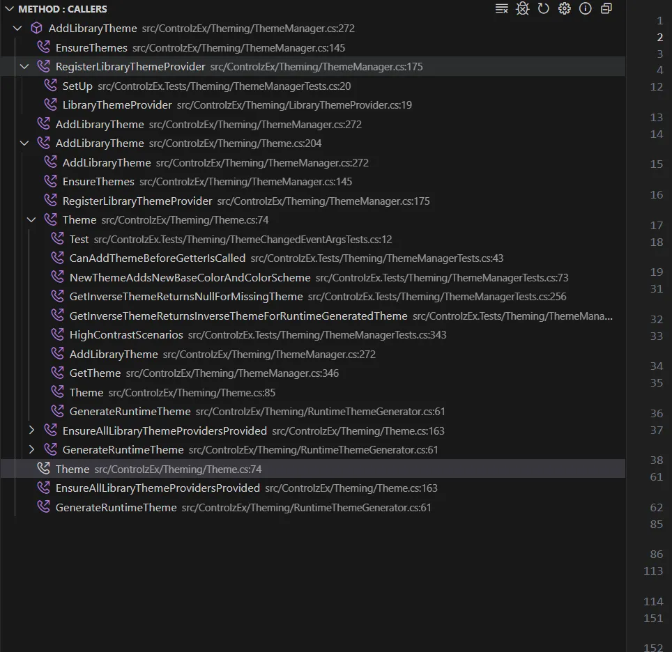

> Reading unfamiliar codebases is mostly tracing who calls a method and what that method calls next. Recalls brings multi-level call hierarchy and workspace symbol caching into a single fast VS Code sidebar.

When navigating large repositories, jumping one "Go to References" hop at a time quickly loses context. **Recalls** is a Visual Studio Code extension that performs configurable-depth recursive call analysis across an entire workspace — surfacing both incoming callers and outgoing internal calls alongside a live file symbol tree.

### Key Capabilities

- **Inspect Methods (Incoming Callers)** : Recursively resolves every method that calls into a selected symbol across files, with configurable traversal depth (1–10 levels) and cycle detection.
- **Internal Method Calls (Outgoing Flow)** : Extracts every method invoked *within* the body of a selected method so developers can read control flow top-down without opening dozens of tabs.
- **Live Symbols Tree** : Displays a filterable hierarchical symbol outline for the active editor with instant jump-to-definition.

### Architecture & Caching

Naively running language-server reference queries recursively on every selection stalls on medium-to-large workspaces. To keep navigation responsive, Recalls builds a layered **`WorkspaceSymbolCache`** in the background:

1. **Background Workspace Indexing** : Waits for underlying language servers (TypeScript, JavaScript, C#, Python, C++, Java) to activate, then indexes document symbols and call sites asynchronously with progress reporting.
2. **Pre-Indexed Reference & Definition Maps** : Maintains direct symbol-name and call-location lookup tables with deduplication and built-in runtime method filtering.
3. **Incremental File-Change Invalidation** : Hooks into VS Code workspace file watchers so edits invalidate and refresh only affected files rather than rebuilding the full index.
